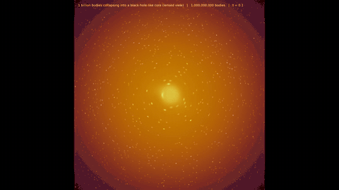
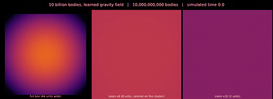
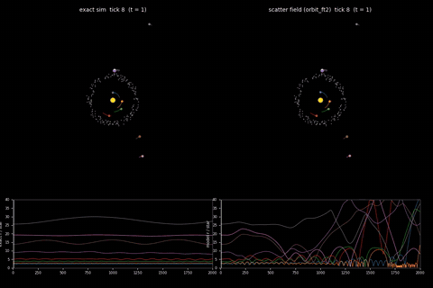
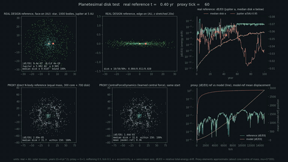
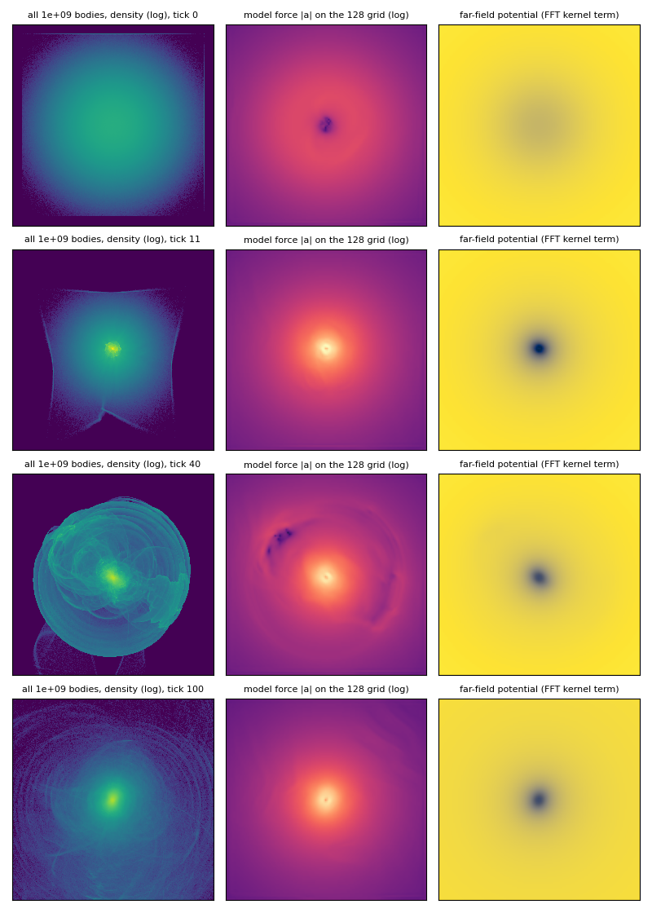

# Augur

**Learning particle simulators that scale, tile, and stay honest about what they get wrong.**

Augur is a research project by Adam Webb (GitHub: Faraday-dot-py) on neural surrogate simulators: models that learn the rules of a particle system from examples, then run it fast enough for real-time and very large scenes. The first commit is dated 2026-09-21; the repository has 705 commits as of 2026-11-09.

[Augur live demos](https://faraday-dot-py.github.io/Augur/) run in the browser.

## Contents

- [Showcase](#showcase)
- [The four requirements](#the-four-requirements)
- [What exists today](#what-exists-today)
- [Newest work: the tiered architecture](#newest-work-the-tiered-architecture)
- [How the research is run](#how-the-research-is-run)
- [Who this is for](#who-this-is-for)

## Showcase

Each preview below is a short silent loop; click it, or the link under it, for the full video on YouTube. Each caption says whether the video is a model rollout or a reference simulation. The 1 billion and 10 billion body videos are not accuracy claims: at that size there is no exact reference, so those videos show that the model runs and stays stable, not that it is right.

### Black holes

<a href="https://youtu.be/QKrhDOiUdoA">Watch on YouTube: 1 billion bodies falling into a black hole-like core</a>

A cloud of 1 billion bodies collapses into a dense core while the background stars bend around it, as light would near a black hole. Model rollout: scatter-field network (defined under "What exists today"), 300 ticks (a tick is one simulation time step). The lensing is a rendering effect computed from the body density, not part of the physics model. Speed and stability result only.

<a href="https://youtu.be/i-HQeElSLnY">Watch on YouTube: 10 billion body gravity collapse at three zoom levels</a>

The same collapse with 10 billion bodies, shown as density at three zoom levels. Model rollout: scatter-field network, 100 ticks, a median 13.4 s per tick and 87 GB peak memory on one GPU (graphics processing unit). Speed and memory result only. The bright frame around the full-box panel is consistent with bodies piled on the clipped edge of the starting cloud.

### Solar systems

<a href="https://youtu.be/sjKpVZJndvk">Watch on YouTube: a star, 8 planets, a moon and a belt, exact vs learned</a>

A star, 8 planets, one moon and a belt of small bodies, exact simulation on the left and the learned scatter-field model on the right. Model rollout against an exact reference. With the grid-edge fix, no planets are lost by tick 1000 (median orbital period error 17 percent), and 5 of 8 are lost by tick 2000. This model was not designed for a heavy central star, and the video shows where it breaks.

<a href="https://youtu.be/JATcW5RJXYY">Watch on YouTube: planetesimal disk around a star</a>

A star with 1000 small bodies and one Jupiter-mass planet at 5 AU (astronomical units, the Earth-Sun distance) over 100 years, seen face-on and edge-on, with an in-range toy version beside a learned model. The top row is an exact direct N-body reference (gravity only, a toy: no gas, so it does not model how planets actually form). The bottom row is a learned model on a toy version with equal-mass bodies, and it fails: its error grows past the kill line after about 100 ticks. The learned models handle only equal-mass bodies today, so the real star-to-planetesimal mass ratio (1000 to 1) is out of range until per-body-mass support is trained.

## The four requirements

Every design choice is judged against four requirements, and the project reports where each one stands rather than where it hopes to be.

| Requirement | What it means | Status |
| --- | --- | --- |
| Generalization | One approach should work for any particle system, including ones with different rules (gravity, contact, molecular forces). | Shown on a handful of systems, not yet on arbitrary ones. |
| Tileable | A model trained on a small region should simulate a much larger one by cutting it into tiles. | Working for gravity, with a known seam and accuracy cost. |
| O(N) cost | Time grows linearly with the number of bodies N, never quadratically. | Measured, see below. |
| Interpretability | The learned rules should be recoverable from the model. | Partly probed, not achieved: a force-law probe recovered some laws and not others (see "Newest work"). |

## What exists today

### Scale

The newest model family, the scatter field, deposits each body onto a grid, applies a convolutional network to the grid, and reads forces back at each body. That keeps cost linear. On one H200 GPU it advanced a 1-billion-body gravity scene (a black-hole-style cluster) for 100 ticks at a median 1.33 s per tick and 16 GB peak memory, using 16-bit body state (`docs/debugging/scatter-bh-1b.md`). The later grid-edge-fixed run measured 1.39 s per tick and 14 GB over 300 ticks (`docs/debugging/experiment-log.md`, job 4068). An earlier token-per-ball model ran 1 billion bouncing balls for 300 ticks in 3,825 s (12.75 s per tick, 121 GB peak), with measured linear scaling from 1 million to 100 million balls (fitted exponent 0.96 to 0.99; `docs/architectures.md`).

These are speed and memory results. No accuracy claim is made at 1 billion bodies, because no exact reference exists at that size; accuracy is measured separately at small N. At 100,000 bodies against an exact simulation, position error grows from 0.073 at tick 5 to 1.33 at tick 20 and 18.9 at tick 100, so the model tracks the exact run for roughly 20 ticks and then drifts (`docs/architectures.md`, experiment-log job 4081).

The figure above shows the same scene with 1 billion bodies and the grid-edge fix: the potential of the kernel term is taken one cell beyond each grid side, with the trained weights unchanged. The earlier version of this figure (`videos/scatter_bh_1b_panels_frames.png`) showed a bright frame in the force panel. That frame was an artificial force near the grid border: at 1 million bodies the mean ratio of model force to exact force was 91 and 62 in the two outermost cell bands at tick 0 (77 and 108 at tick 100), against about 1.8 in the interior (`results/bh_edge_zero_1e6_edgecheck.json`). It is gone in the fixed model, with no rim in the force panel at any of the four ticks (the figure scatter_bh_edge_old_vs_fixed_force_1e6.png in videos/ shows the old and fixed force maps side by side). A constant model-to-exact ratio of about 1.55 remains everywhere, interior included; it is a separate scale or softening difference that has not been investigated.

### Browser

A live site runs the models client-side: the token (contact) model, the central-force gravity model, the scatter-field gravity model, and a 3D step-through of one scatter-field forward pass (`web/README.md`). A WebGPU (in-browser GPU) port of the scatter network passes its numerical check against the CPU path (maximum relative difference 2.4e-6). Its speed has not been measured on a real GPU, so there is no speedup claim.

### Interpretability tooling

The 3D walkthrough helps people see what the model does; it is not the same as recovering rules. Rule-recovery probes are described under "Newest work".

## Newest work: the tiered architecture

The scatter field is local: it sees a bounded neighborhood. The current design stacks tiers. A tier-0 model handles fine-scale physics in a tile; a tier-1 tile governs a 2x2 block of tier-0 tiles, and so on, with identical architecture at every level and separate weights per level. The hope is long-range physics at near-constant cost per level, and a path to scenes far larger than any training region. This design was worked out as a written theory document (`docs/theory/heterogeneous-tiered.md`) with ten identified weak points, each walked through and given a proposed test before any code was run.

In the table, err@20 is the mean position error per body after 20 ticks, dE@100 is the relative energy drift at tick 100, and "baseline" is the tiled scatter-field model the hierarchy is compared against. "KILL" means a pre-registered failure line was crossed.

| Milestone | State | Source |
| --- | --- | --- |
| Scatter field, gravity, linear cost, 1B-body speed run | done | `docs/architectures.md` |
| Tiled inference with seams checked | done, with accuracy cost | `docs/architectures.md` |
| Browser demos and 3D walkthrough | done | `web/README.md` |
| WebGPU network port, numerics | done | unexplored-directions-audit-2026-10-29.md, row 37 |
| WebGPU network port, speed | not measured (needs a real-GPU browser run) | same |
| Tier 0 at matched training budget | passes every pre-registered criterion on its first seed; the tiled closed-loop version passes the err@20 line on 4 of 4 training seeds | supervisor-log.md:111; experiment-log.md:3650-3655 |
| End-to-end hierarchy accuracy | KILL: about 1.6 to 2.4x the tiled baseline's err@20 depending on variant | supervisor-log.md:110, 122 |
| Retrain removing velocity and recurrent inputs | KILL on both seeds (err@20 1.56 to 1.85x baseline, dE@100 6.0 to 7.3x) | supervisor-log.md:122 |
| Local energy-bias loss terms | KILL on both seeds, no gain over control | supervisor-log.md:124 |
| Tiled closed-loop tier 0 with halo exchange | err@20 0.75 to 0.82x baseline (passes), dE@100 3.9 to 4.8x baseline (fails) | supervisor-log.md:127 |
| Visited-state label replay fine-tune | dE@100 cut from 4.25x to 1.99x baseline (seed 4738) and 4.78x to 1.88x (seed 4739); a truth-state control gave a similar cut, so the cause is not settled | experiment-log.md:3659 |
| Per-body-mass support (planet-and-disk systems) | design, curriculum and trainer written and unit-tested; not trained | supervisor-log.md:26 |
| Interpretability (recovering the rules) | partial, see below | supervisor-log.md:167-171 |

Two diagnoses made the hierarchy gap specific. First, a mid-density bias that looked architectural turned out to be mostly undertraining: the matched-budget tier 0 closed it (bias from -1.46 and -1.78 to -0.118 and -0.052; supervisor-log.md:99, 111). Second, teacher-forced analysis located the remaining hierarchy error in the dense regions of the tier-0 model (its energy-work error there is 2.1x the baseline's), not in the upper tiers (supervisor-log.md:113). The targeted retrain that followed did not fix it, and the remaining gap is a visited-state effect: force error is 1.5 to 1.6x baseline at the model's own free-rollout states but only 6 to 12 percent above it when states come from the exact run (experiment-log.md:3369; supervisor-log.md:122).

Per-body-mass support targets a star-plus-planetesimal-disk system, the kind of mixed-mass scene robotics and astrophysics both care about. The current models only handle unit-mass bodies. A direct N-body reference for the real disk design is validated (relative energy drift 2.4e-5 over 100 simulated years), a 500-frame comparison video was rendered and reviewed, and the mass-conditioned model has pre-registered pass and kill lines (supervisor-log.md:116, 119). It has not been trained.

### Recent probes, as of 2026-11-09

- **Force-law recovery.** Probing the two-body force of the six-law mixed checkpoint (distance 0.25 to 14) recovered the power-law exponents for pow1, pow2 and the long-range Yukawa law (a screened force) on one checkpoint; the short-range Yukawa laws were not stable, and a second checkpoint missed pow1. Registered verdict: INCONCLUSIVE_PARTIAL (supervisor-log.md:171). Against a plain same-grid particle-mesh force at N = 1000, the learned model was at least 2x better at median and 90th percentile on two of three held-out families; on the Plummer family the 90th-percentile ratio was 1.82 (supervisor-log.md:167).
- **Mixed-law retrain without amplitude-10 power-1 scenes.** KILL: gravity err@20 33.08 against a kill edge of 0.106 (one training seed; the training was also unstable) (experiment-log.md:3863-3865).
- **Shift-consistency probe.** PASS: median force change under a half-cell shift exceeded 2 percent on all six laws, so a shift-consistency loss is justified by the pre-registered line (experiment-log.md:3833-3836).
- **Neighbor selection at 3 million bodies.** The adaptive pair-term neighbor search disagreed with a brute-force reference on one body: KILL by the line as first written, PASS under a tie-aware rescoring written after the KILL was known. The disagreement is a tie at the 16th and 17th neighbor, so the output is tie-sensitive (experiment-log.md:3841-3846, 3887-3891). One body, one seed.

## How the research is run

Work is done by a supervised team of AI agents. A supervisor agent delegates, records every decision in a running log (`docs/theory/supervisor-log.md`), and does not do experiment work itself. Each agent works in its own branch, writes pass and kill criteria before running, and logs results to a shared experiment log (`docs/debugging/experiment-log.md`, 97 sectioned entries). When an agent hits a limit or loses its compute connection, it is resumed from saved state. After every run that produces rollouts, a fresh reviewer with no hypothesis primed describes the rendered frames, because summary statistics alone have repeatedly hidden visible artifacts. Experiment names must be descriptive, enforced by a check script (`scripts/check_experiment_names.py`).

Many results are negative, and that is part of the method. Pre-registered kill lines mean a failed arm is recorded as a result, not tuned away. A selection of what did not work and what it taught:

- **Upper tiers on a frozen tier 0** did not reduce far-field error. Several levers (higher-order moments, more data, longer training) were then tried one at a time, and the limit was the frozen base, not what the upper tiers pass up. (supervisor-log.md:46, 69, 76)
- **Joint fine-tuning of all tiers** cut some errors but raised energy drift roughly 6x on the earlier tier 0, and added nothing over sequential training on two later runs. (supervisor-log.md:69, 110, 122)
- **A molecular-dynamics scatter field** drifted in energy because of velocity and history inputs: zeroing them, with no other change, cut the drift to within about 0.013. On gravity the same input removal halved the energy drift but the end-to-end retrain with it was a KILL (see the table). (supervisor-log.md:62, 87)
- **A six-law mixed-interaction model** is about 2.6x worse on gravity than the gravity-only model (err@20 0.106 against 0.041), and the retrain that capped the amplitude of power-1 scenes made it far worse. (experiment-log.md:3863-3865)
- **A planetesimal-disk proxy** with the existing unit-mass model was killed, which is why per-body-mass support is being built rather than assumed. (supervisor-log.md:116)
- **A loss-function analysis** showed the error is not driven by a few outlier particles, so the tail-focused loss idea was dropped for the tiered arms; the local energy-bias terms proposed instead were then killed too. (supervisor-log.md:117, 124)

Results are logged with the numbers that decide them, so a reader can see which claims are strong (linear cost, tier-0 gravity, the energy diagnosis) and which are one seed or untested.

## Who this is for

- **ML research and applied science:** pre-registered experiments, held-out-seed selection, and a documented record of negative results.
- **ML engineering and infrastructure:** O(N) design, tiling, 16-bit state for fitting 1 billion bodies on one GPU, GPU-side data generation, and a WebGPU port.
- **Robotics and simulation:** learned surrogates for real-time simulation, contact dynamics, and mixed-mass systems.

## Compute

Training and large-scale runs were done on the Polaris supercomputer cluster at Cal Poly Pomona (CPP). See CPP's page on [High-Performance Computing](https://www.cpp.edu/it/advanced-computing/high-performance-computing.shtml).

## Contact

awebb3124@gmail.com
